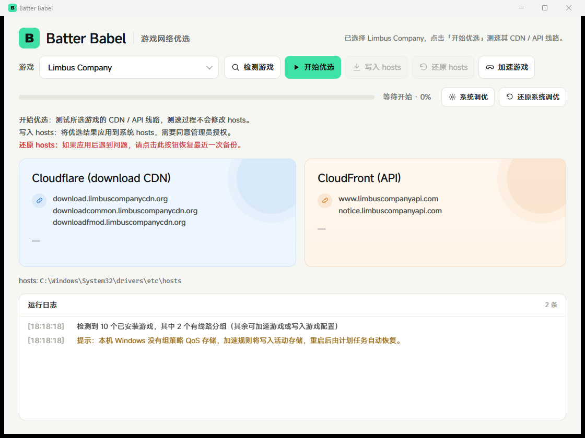

# Batter Babel

A Windows desktop tool that picks faster CDN / API routes for installed games, applies them to `hosts`, and provides game acceleration, system network tuning and boot-time recovery.

[中文](README.md) · [Download 1.0](https://github.com/AZ7094/batter-babel/releases)



## Features

- **Game discovery**: scans Steam / Epic installs and running processes; ships 7 built-in profiles (Limbus Company, CS2, Apex, Hunt, …).
- **Route optimization**: a 2,000-address Cloudflare pool → TCP pre-screen → download finals → per-domain HTTPS verification, with 10 curated addresses and a learned-IP library (`cf-good-ips.json`) competing in the same run.
- **hosts apply / restore**: full-file snapshot, atomic replace, read-back verification; only the program's own marker block is touched.
- **Game acceleration**: raises the game process priority and applies a QoS DSCP policy per executable when the platform supports it.
- **System tuning**: receive-window auto-tuning, RSS and related network settings with snapshot-first writes and one-click restore.
- **Boot recovery**: re-applies hosts / QoS policies at sign-in so ActiveStore policies survive a reboot.
- **Chinese / English UI**: one-click language switch in the header, remembered across launches.
- **Logging and error handling**: every action is recorded in the in-app log, with readable failure reasons.

## Requirements

- Windows 10 1809+ / Windows 11, x64.
- The release build is **self-contained**: no .NET runtime installation required.
- Microsoft Edge WebView2 Runtime: bundled with Windows 11; on Windows 10 the app shows a download link if it is missing.

## Usage

Download `BatterBabel-1.0-win-x64.zip`, extract it and run `BatterBabel.exe`. No installer needed.

Optional command line:

```
BatterBabel.exe --web-check            page/host bridge self-check (13 assertions)
BatterBabel.exe --web-shot             first-screen screenshot into the evidence folder
BatterBabel.exe --web-live --apply     real measurement → write hosts → restore
BatterBabel.exe --scan-dump out.json   export the game scan
BatterBabel.exe --optimize-dump out.json --game limbus   export a real optimization run
BatterBabel.exe --install-recovery     install the sign-in recovery task (admin)
BatterBabel.exe --hosts-selftest out.json   hosts transaction self-check in a temp folder
```

Data folder: `%LOCALAPPDATA%\BatterBabel\` (hosts backups, tuning snapshot, recovery state, learned IPs, WebView2 cache).

## Build from source

Requires the .NET 10 SDK. The WebView2 package is vendored in `wpf/packages/`, so a fresh clone restores without network access:

```
dotnet build wpf/BatterBabel.sln -c Release
dotnet run --project wpf/src/BatterBabel.App
```

Self-contained publish:

```
dotnet publish wpf/src/BatterBabel.App -c Release -r win-x64 --self-contained true
```

## Self-checks

```
dotnet run --project wpf/tools/BatterBabel.SelfCheck      # 56 core assertions
dotnet run --project wpf/tools/BatterBabel.TuneCheck      # tuning engine
dotnet run --project wpf/tools/BatterBabel.ConfigCheck    # managed game-config blocks
dotnet run --project wpf/tools/BatterBabel.QosCheck       # QoS policies
dotnet run --project wpf/tools/BatterBabel.RecoveryCheck  # boot recovery
dotnet run --project wpf/tools/BatterBabel.RouteQosCheck  # per-target-IP policies
node --test tests/final-ui.test.js                        # front-end contract
```

## Layout

```
wpf/src/BatterBabel.App     WPF + WebView2 host, RPC bridge, action implementations
wpf/src/BatterBabel.Core    discovery, route probing, hosts, QoS, tuning, recovery
wpf/tools/                  per-subsystem self-check programs
src/web/                    UI (HTML/CSS/JS + MiSans webfont + icon)
assets/icons/               application icon set (SVG/PNG/ICO)
tests/                      front-end contract tests
```

## Known limitations

- Per-target-IP QoS policies are rejected on this machine's Windows 10.0.26200 (the provider drops the match condition); the app detects this and refuses to write instead of pretending success.
- Without a Group Policy QoS store, policies go to the active store and need the sign-in recovery task after a reboot.
- Measurements depend on the public network and vary between runs; the UI shows the measured values of the current run.

## License

MIT — see [LICENSE](LICENSE).

The UI uses the **MiSans** typeface (Xiaomi); see [assets/fonts/LICENSE-MiSans.txt](assets/fonts/LICENSE-MiSans.txt) and <https://hyperos.mi.com/font/faq>.
